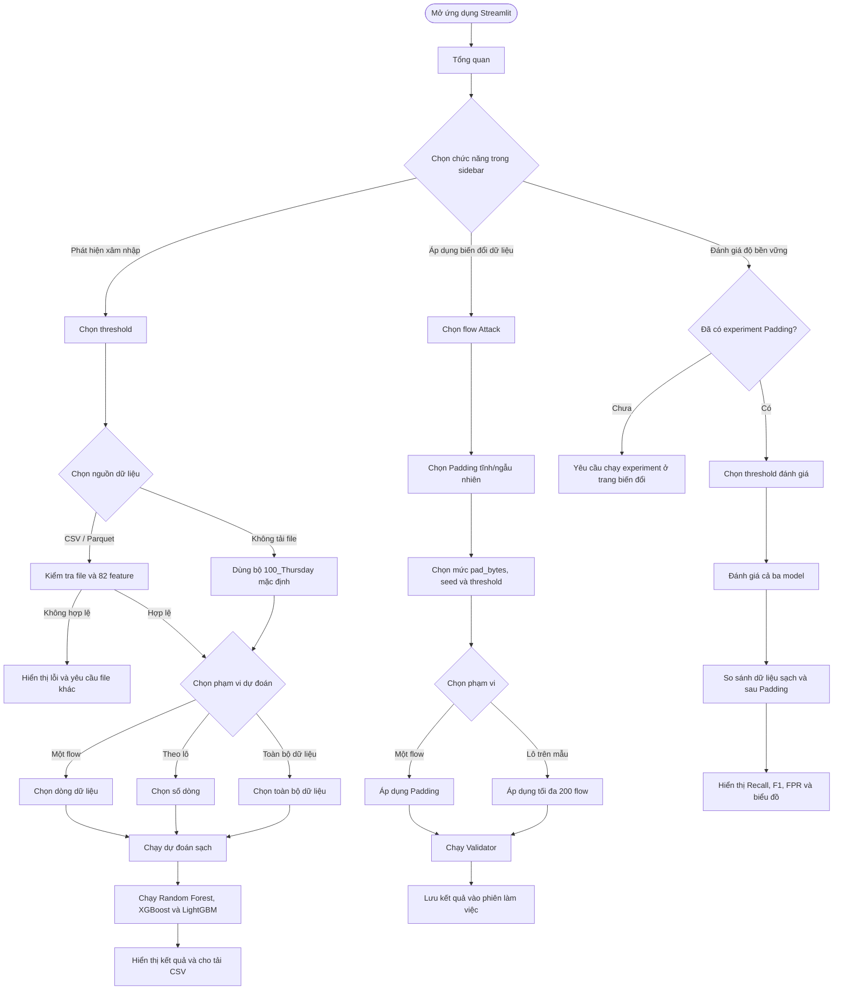

# DGT NIDS Robustness

## Giới thiệu

DGT NIDS Robustness là ứng dụng Streamlit hỗ trợ phát hiện xâm nhập mạng và
đánh giá độ bền vững của các mô hình NIDS. Ứng dụng sử dụng Random Forest,
XGBoost và LightGBM đã được huấn luyện trên dữ liệu chia theo ngày. Người dùng
có thể dự đoán dữ liệu sạch, áp dụng Padding ở cấp đặc trưng và kiểm tra kết quả
bằng Validator. Kết quả trước và sau biến đổi được so sánh qua các chỉ số Recall,
F1 và FPR. Dự án được xây dựng phục vụ công việc thực tập tại công ty DTG.

## Video demo

[](https://www.youtube.com/watch?v=D5Tw-m7Jx48)

## Cấu trúc dự án

```text
.
├── artifacts/
│   └── models/
│       ├── lightgbm.joblib
│       ├── random_forest.joblib
│       └── xgboost.joblib
├── data/
│   ├── 100_Friday_non_scale.parquet
│   ├── 100_Thursday_non_scale.parquet
│   ├── 100_Thursday_scaled.parquet
│   └── scaler_day_based_82.joblib
├── notebooks/
│   ├── Khoa_Models/
│   │   ├── A_theo_ngay_huan_luyen_danh_gia.ipynb
│   │   ├── B_70_15_15_huan_luyen_danh_gia.ipynb
│   │   └── C_so_sanh_hai_nhanh.ipynb
│   ├── Tien_Adversarial_Perturbation/
│   │   ├── A_padding_on_day_test.ipynb
│   │   ├── B_padding_on_15_test.ipynb
│   │   └── robustness_evaluation/
│   │       ├── A_Eval_Robustness.ipynb
│   │       ├── B_Eval_Robustness.ipynb
│   │       ├── nhan_xet_ket_qua_A_Eval_Robustness.md
│   │       ├── nhan_xet_ket_qua_B_Eval_Robustness.md
│   │       └── so_sanh_nhanh_A_day_based_vs_B_70_15_15.md
│   └── Trung_Data/
│       ├── EDA.ipynb
│       ├── tuan2_kiemke_ganNhan_CIC_IDS_2017.ipynb
│       ├── tuan3_cleaning_kiemtra_thongke_theo_ngay.ipynb
│       └── tuan4_preprocessing_leakage_check.ipynb
├── src/
│   ├── __init__.py
│   ├── data_service.py
│   ├── evaluation.py
│   ├── model_service.py
│   ├── perturbation.py
│   └── validator.py
├── .dockerignore
├── .gitignore
├── app.py
├── Dockerfile
├── README.md
└── requirements.txt
```

## Các tính năng chính

- **Phát hiện xâm nhập:** Dự đoán một flow, một lô dữ liệu hoặc toàn bộ dữ liệu
  bằng Random Forest, XGBoost và LightGBM. Người dùng có thể chọn threshold,
  xem xác suất Attack và tải kết quả dự đoán dưới dạng CSV.
- **Áp dụng biến đổi dữ liệu:** Áp dụng Padding tĩnh hoặc Padding ngẫu nhiên
  trên các flow Attack ở cấp đặc trưng. Mỗi biến đổi được kiểm tra bằng
  Validator và kết quả được lưu trong phiên làm việc.
- **Đánh giá độ bền vững:** So sánh dự đoán trên dữ liệu sạch và dữ liệu sau
  Padding với cùng ba mô hình. Giao diện hiển thị các chỉ số Accuracy, Recall,
  F1, FPR và biểu đồ so sánh kết quả.

## Yêu cầu (requirements)

- Python 3.11 trở lên.
- Windows PowerShell hoặc Docker Desktop.
- Các thư viện Python được ghim phiên bản trong
  [requirements.txt](requirements.txt):

```text
streamlit==1.67.0
pandas==3.1.1
numpy==2.4.6
plotly==7.1.0
joblib==1.6.0
scikit-learn==1.8.0
xgboost==3.2.0
lightgbm==4.7.0
pyarrow==26.0.1
```

## Hướng dẫn tải

```powershell
git clone https://github.com/AIVIETNAM-AIO-TienNguyen/TTTN_NIDS_Robustness.git
Set-Location TTTN_NIDS_Robustness
```

## Hướng dẫn chạy

### Chạy trên Windows PowerShell

```powershell
python -m venv .venv
.\.venv\Scripts\Activate.ps1
python -m pip install --upgrade pip
python -m pip install -r requirements.txt
python -m streamlit run app.py
```

Nếu PowerShell chặn script kích hoạt, chạy:

```powershell
Set-ExecutionPolicy -Scope Process -ExecutionPolicy Bypass
.\.venv\Scripts\Activate.ps1
```

### Chạy bằng Docker

```powershell
docker build -t dgt-nids:latest .
docker run --rm -p 8501:8501 dgt-nids:latest
```

Mở [http://localhost:8501](http://localhost:8501) trên trình duyệt.

## Hướng dẫn sử dụng



## Thành viên

```text
- Nguyễn Thanh Phong – Leader
- Trọng Minh Trung - Data Analysis
- Phạm Bùi Đăng Khoa - Models
- Nguyễn Xuân Tiến - Perturbation
```
